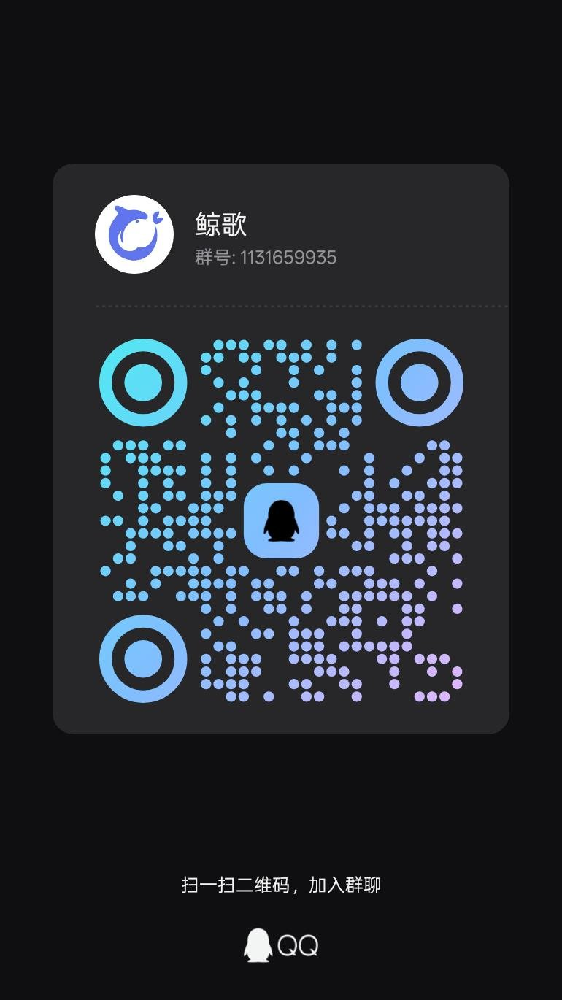

# 鲸歌 · DSH Native

> [!WARNING]
> **开发阶段｜Work in Progress**
>
> 本项目仍在**活跃开发中**：功能、界面、数据格式和接口都可能随时改动，**不保证稳定性**，
> 请勿用于生产环境。目前所有发行版都是**预发布（pre-release）**。
>
> 非常需要各位用户的反馈：遇到 bug、功能缺失、体验问题，欢迎提
> [Issues](https://github.com/yimengbuzizhi/dsh-native/issues)，或加 QQ 群 **1131659935**（群名「鲸歌」）。
> 你的反馈会直接影响后续开发方向。

在 Android 手机上运行的 AI Agent 客户端：**Kotlin + Jetpack Compose 原生 UI**，
内置 Kotlin 原生 Agent 内核（不依赖 Node、不依赖 WebView）。

> 本项目是 DSH（DeepSeek Harness）手机版的原生重写。DSH 的协议、提示词与工具 schema
> 以 npm 包 `@deepseek-ai/dsh` 为基线移植（见 `upstream.toml`），App 代码全部自写。

## 功能

- **对话**：流式输出、思考过程折叠、工具调用卡片、审批、计划模式、语音输入条、多模态图片、
  引用附件折叠 chip（模型拿全文，界面只显示可展开的一行）
- **多会话并行**：A 会话生成中可以切到 B 继续发消息，互不阻塞；后台会话在等审批/提问时，
  聊天页顶部会出横幅提示并可一键切过去
- **Agent 内核**：工具循环、自动/手动审批、子代理（subagent）、目标（goal）、后台任务（jobs）、
  定时任务、技能（SKILL.md）、上下文自动压缩
- **助手配置**：多份角色卡（名字/头像/简介/人设/开场白/系统提示词），侧边栏一键切换；
  人设与系统提示词按 DSH 语义注入，插件自带的助手配置只读展示
- **插件**：本地导入 JS 插件（QuickJS）＋ **DSH 社区插件兼容**（客户端界面宿主、提示词变量与
  预设插件、权限/配置模型）＋ **Operit 工具包**（31 个内置包一键安装，`Tools.*` 兼容层）。
  APK 只带宿主与适配层，**插件本体不随安装包分发**，由用户自行导入
- **记忆库**：Operit 式记忆库（SQLite、文件夹、图谱、搜索、8 个记忆工具）
- **设备能力**（可选，需要 Shizuku / 无障碍 / 悬浮窗权限）：
  - 读屏、点击、手势、截图（无障碍）
  - 虚拟屏（Shower：在后台显示另一个 App，可转发触摸）
  - 终端（PTY / proot Ubuntu rootfs）
  - 悬浮球（应用不在前台自动出现）
- **会话**：v4 会话格式、工作区、备份/恢复、旧版备份只读导入
- **模型**：多家供应商接入、模型列表多选、只切换已启用的模型
- **隐私与数据清理**：占用统计 + 网页缓存/Cookie、临时文件、头像缓存一键清理（二次确认）
- **外壳**：RikkaHub 式聊天落地 + 抽屉，Operit 式设置分组，深色/浅色主题、自定义强调色；
  宽屏（折叠屏/平板）常驻侧边栏

## 构建

要求：JDK 17+、Android SDK（compileSdk 34）、Gradle 8.9。

```bash
./gradlew :app:assembleDebug
```

产物：`app/build/outputs/apk/debug/app-debug.apk`

首次构建会从 Google/Maven Central 拉依赖；`local.properties` 里写 `sdk.dir=<Android SDK 路径>`。

## 模块

| 目录 | 内容 |
|---|---|
| `app/` | Android 应用（UI + Activity/Service + 设备桥） |
| `core/` | Agent 内核：engine / tools / prompt / session / protocol / llm / plugins / workflow / jobs / agents / skills / attachment / parity |
| `ui/design/` | Compose 设计系统（颜色、字阶、组件） |
| `thirdparty/` | Operit 的 showerclient 与 OperitTerminalCore（源码复制，LGPL-3.0，见 `NOTICE.md`） |
| `docs/` | 设计、契约、移植与真机验收记录（开发过程文档） |
| `parity/` | 门 2 对拍夹具（SSE 录制/回放，逐字节比对） |

## 使用前提

- 一个 DeepSeek 账号或 API Key（设置 → 模型与参数配置）
- 设备能力都是可选的：不装 Shizuku 也能纯聊天；要用虚拟屏/终端才需要 Shizuku
- 社区插件（`dsh.client` / DSH 插件包 / Operit ToolPkg）需要自己导入，安装包不内置第三方插件

## 反馈与贡献

- **项目仍在开发阶段，非常需要真实使用反馈**：BUG、卡顿、交互不顺、缺什么功能，都可以提
  [Issues](https://github.com/yimengbuzizhi/dsh-native/issues)，或加 **QQ 群 1131659935**。
- 提问题时尽量带上：手机型号 / Android 版本 / App 版本（设置 → 关于 → 版本）、复现步骤；
  闪退或设备工具异常时附 logcat 会很有帮助。
- 欢迎 PR；提交前请确认 `./gradlew :app:assembleDebug` 能通过。
- 所有发行版都是**预发布（pre-release）**，不保证稳定，请按预览版对待。
- 每个版本的更新内容见 [Releases](https://github.com/yimengbuzizhi/dsh-native/releases)。



## 许可证

[LGPL-3.0](LICENSE)。第三方来源与许可声明见 [NOTICE.md](NOTICE.md)。

## 致谢

- [Operit](https://github.com/AAswordman/Operit)（LGPL-3.0）：showerclient、OperitTerminalCore、
  Operit 自带工具包、部分 UI 信息架构
- [RikkaHub](https://github.com/rikkahub/rikkahub)（AGPL-3.0）：只参考信息架构与排版，未复制代码
- [QuickJS](https://github.com/bellard/quickjs)（MIT）：插件/工作流 JS 引擎
- [React](https://react.dev)（MIT）：客户端插件宿主的 React 18.3.1 UMD 运行时
- DSH 上游 `@deepseek-ai/dsh`：协议、提示词与工具 schema
