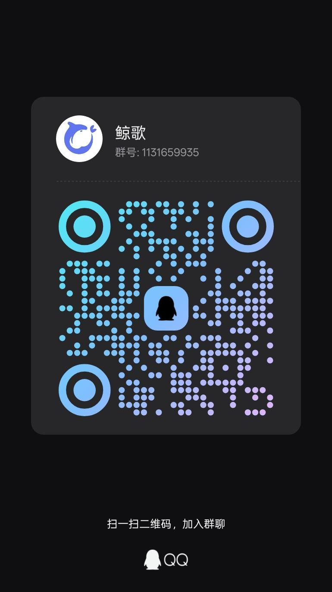

# 鲸歌 · DSH Native

> [!WARNING]
> **开发阶段｜Work in Progress**
>
> 本项目仍在**活跃开发中**：功能、界面、数据格式和接口都可能随时改动，**不保证稳定性**，
> 请勿用于生产环境。目前所有发行版都是**预发布（pre-release）**。
>
> 非常需要各位用户的反馈：遇到 bug、功能缺失、体验问题，欢迎提
> [Issues](https://github.com/yimengbuzizhi/dsh-native/issues)，或加 QQ 群 **1131659935**（群名「鲸歌」）。
> 你的反馈会直接影响后续开发方向。

在 Android 手机上运行的 AI Agent 客户端：**Kotlin + Jetpack Compose 原生 UI**，
内置 Kotlin 原生 Agent 内核（核心链路不依赖 Node、不依赖 WebView；Node 插件宿主是可选的实验能力，默认关闭）。

> 本项目是 DSH（DeepSeek Harness）手机版的原生重写。DSH 的协议、提示词与工具 schema
> 以 npm 包 `@deepseek-ai/dsh` 为基线移植（见 `upstream.toml`），App 代码全部自写。

## 一切皆插件（Everything is a Plugin）

鲸歌的目标不是「支持插件」，而是**宿主只留骨架**：工具、页面、提示词、模型、回合循环、会话存储、
界面壳、启动加载页、设备能力、斜杠命令、角色预设……每一类都可以由插件**提供、替换或停用**。
仓库里的内置实现同样以「内置插件」注册，和第三方插件走同一套开关、权限与回退路径。

> 默认界面仍是原生 Compose UI（`builtin.shell.native`）；另可选内置「液态玻璃」外观
> （`dsh_shell=liquid`）。插件化是「可替换」，不是重画界面。

### 双插件宿主（0.3.6 起）

插件页分 **原生 / Node** 两区，两套宿主共享同一套插件页、权限与停用/回退路径：

| | 原生插件 | Node 插件（实验） |
|---|---|---|
| 运行方式 | QuickJS，与 App 同进程 | 独立 `libnode.so` 进程（真 Node 运行时，arm64） |
| 包形状 | zip（入口 JS + manifest，可带 `dsh.client` 客户端界面） | zip **或目录**，真 npm 包形状（`node_modules` 随包或只用宿主已提供的包） |
| 能注册什么 | 工具、页面、界面壳、加载页、提示词、模型、回合、存储、能力、事件/投影 | 工具、模型供应商（`node:*`）、斜杠命令、提示词段、角色预设（**v1 无 UI 桥**） |
| 导入限额 | 包 64MB / 单文件 32MB / 解压 64MB / 5000 条目 | 包 64MB / 单文件 32MB / 解压 256MB / 20000 条目 |
| 默认 | 开（导入即用） | **关**（开关打开后首次解压运行时约 3–4 秒） |
| 故障处理 | 停用后回退内置实现，不丢会话 | 失败横幅 + 下次开机跳过自动启动；坏插件连续 2 轮加载失败**自动隔离**；`node-audit.jsonl` 审计、日志脱敏 |

> Node 宿主还带 9 个 AI 可用的 `nodehost_*` 工具：`status` / `plugins` / `logs` / `doctor` / `control` /
> `repair` / `autofix` / `install` / `uninstall`——能看状态、诊断、启动/停止、重装运行时（不动插件文件）、
> 隔离坏插件。写操作按全局审批档处理并进审计。

### 能被替换的角色

| 角色 | 插件接口 | 内置默认实现 | 说明 |
|---|---|---|---|
| 工具 | `ctx.tools.register` | `builtin.fs` / `builtin.shell` / `builtin.web` … | 先登记者生效；参数需能转成 JSON Schema |
| 页面 | `ctx.ui.registerRoute/registerPage` + `dsh.client` | `builtin.page.*`（原 Kotlin 页面） | 客户端插件用 React bundle 渲染；容器支持 fullscreen / floating / sheet |
| 系统提示词 | `ctx.systemPrompt.register`（prompt/v1） | `builtin.prompt.dsh` + 可关的 `builtin.prompt.core` | 整体拼装可换；段/变量仍可叠加 |
| 模型通道 | `ctx.llm.register`（model/v1，配置式或 `stream`） | `builtin.model.deepseek` / `builtin.model.openai` | 插件可直接产出 token 与工具调用；Node 插件注册的出现在「角色 → 模型」的 `node:*` 下 |
| 回合循环 | `ctx.agent.register`（agent/v1） | `builtin.agent.dsh`（原 Kotlin TurnEngine） | JS 回合 v1 只支持纯文本轮 |
| 会话存储 | `ctx.storage.register`（storage/v1） | `builtin.storage.jsonl` | 第三方 v1 只读；写入仍由内置存储负责 |
| 界面壳 | `ctx.ui.registerShell`（surface / webview） | `builtin.shell.native`（默认）、液态玻璃（内置外观，`dsh_shell=liquid`） | 壳负责整屏 UI；停用/崩溃自动回原生 |
| 启动加载页 | `ctx.ui.registerLoading`（loading/v1） | `builtin.loading.native` | 静态树 + 快照，冷启动首帧前显示 |
| 能力 | `ctx.capability.register`（capability/v1） | notify / clipboard / share 平台原语 | root / NFC / Shizuku / ADB 由插件提供 |
| 事件/投影/服务 | `ctx.on` / `ctx.sessionProjections` / `provide`+`inject` | — | 投影 checkpoint 按会话持久化 |

### 怎么用

1. 插件页「导入」：原生插件 zip；Node 插件 zip **或目录**（目录也可以让 AI 用 `nodehost_install` 直接装）。
2. Node 插件要先把插件页顶部开关打开（首次解压运行时约 3–4 秒），两区分别显示状态、工具与日志。
3. 在「插件 → 角色」里选中要用的实现（界面 / 回合 / 存储 / 提示词 / 模型 / 加载页）。
   **安装 ≠ 选中**，不选就一直是内置实现。
4. 出问题：原生插件停用即回退；Node 插件有「重试 / 查看日志」，也可以让 AI 跑
   `nodehost_doctor` → `nodehost_repair`（如 `reinstall-runtime`）→ `nodehost_autofix` 阶梯修复；
   反复加载失败的插件会被自动隔离，其余插件继续可用。

### 边界（不承诺）

- **原生插件**跑在 QuickJS（与 App 同进程）：是能力调用边界与超时控制，不是内核隔离；
  无 npm 安装、无 DOM/Electron、无 DEX/APK 动态加载；相对 import 不解析，依赖要内联。
- **Node 插件**跑真 Node（独立进程）：v1 **没有 UI 桥**（要界面请写原生客户端插件，或用三种容器）；
  包必须自带 `node_modules` 或只使用宿主已提供的包，**不会联网装依赖**；v1 不校验脚本内容哈希，
  脚本损坏靠启动失败发现（可用 `reinstall-runtime` 修）。
- 客户端插件只跑 Web 半侧；`ctx.ui.registerView` / `ui.view` 未实现（上游也没有这个 API）。
- agent/v1 的 `tools.invoke` / `llm.stream` / `storage.append` 仍返回 UNSUPPORTED；
  storage/v1 只读（不能新建/写入/回收站/分支）。
- 危险权限（`fs:any` / `net:*` / `shell` / `device` / `memory`）必须在插件页逐项授权，
  不随安装自动获得；没有提供方时如实显示「不可用」。
- 内置 bash / curl 与 Node 运行时只有 **arm64**；x86_64 模拟器包不含这些原生能力。

### 想深入

- 设计与终点：`docs/115-一切皆插件的终点.md`、`docs/144-M85-宿主骨架与一切皆插件-设计.md`；
  双插件宿主：`docs/185-双插件宿主-原生插件与Node插件宿主共存-方案与交接.md`；
  原语层：`docs/186-原语层-单一定义与三面接口-能力映射.md`；Node 自治：`docs/190-下一轮任务书-返回栈-提示词-Node自治.md`
- 插件作者指南（随 App 以内置技能提供，共 3 个）：`dsh-plugin-authoring`（原生/QuickJS）、
  `dsh-node-plugin-authoring`（真 Node/cordis 插件）、`dsh-plugin-adapter`（DSH/社区插件适配）
- 各版本发布记录与已知限制：`docs/191-发布-v0.3.6.md`、[Releases](https://github.com/yimengbuzizhi/dsh-native/releases)

## 功能

- **对话**：流式输出、思考过程折叠、工具调用卡片、审批、计划模式、语音输入条、多模态图片、
  引用附件折叠 chip（模型拿全文，界面只显示可展开的一行）
- **多会话并行**：A 会话生成中可以切到 B 继续发消息，互不阻塞；后台会话在等审批/提问时，
  聊天页顶部会出横幅提示并可一键切过去
- **Agent 内核**：工具循环、自动/手动审批、子代理（subagent）、目标（goal）、后台任务（jobs）、
  定时任务、技能（SKILL.md）、上下文自动压缩
- **助手配置**：多份角色卡（名字/头像/简介/人设/开场白/系统提示词），侧边栏一键切换；
  人设与系统提示词按 DSH 语义注入，插件自带的助手配置只读展示
- **插件**：**双插件宿主**——原生插件（QuickJS，工具/页面/壳/加载页/提示词/模型/回合/存储/能力）
  与 Node 插件（实验、默认关，真 Node/cordis 包，可注册工具/模型供应商/斜杠命令/提示词段/预设）。
  内置能力以「内置插件」随包提供，全部可停用、可同 id 替换；第三方插件本地导入 zip 或目录，
  兼容 **DSH 社区插件**（客户端界面宿主、提示词变量与预设插件、权限/配置模型）与
  **Operit 工具包**（31 个内置包一键安装，`Tools.*` 兼容层）；客户端容器支持
  fullscreen / floating / sheet。Node 侧带 9 个 `nodehost_*` AI 维护工具、失败横幅、坏插件自动隔离、
  `node-audit.jsonl` 审计与日志脱敏。导入限额：原生 包 64MB / 单文件 32MB / 解压 64MB / 5000 条目，
  Node 包 64MB / 单文件 32MB / 解压 256MB / 20000 条目。APK 只带宿主、内置插件与适配层，
  **第三方插件本体不随安装包分发**
- **工具链**：内置 bash 5.3.20（Termux）+ curl + CA 根证书（118 张）+ PATH/symlink 桥（arm64）；
  `bash` 支持 env/stdin/托管变量，`write`/`edit` 上限 16MB 且支持 `append`；`http_request` 已更名 `curl`
- **记忆库**：Operit 式记忆库（SQLite、文件夹、图谱、搜索、8 个记忆工具）
- **设备能力**（可选，需要 Shizuku / 无障碍 / 悬浮窗权限）：
  - 读屏、点击、手势、截图（无障碍）
  - 虚拟屏（Shower：在后台显示另一个 App，可转发触摸）
  - 终端（PTY / proot Ubuntu rootfs）
  - 悬浮球（应用不在前台自动出现）
- **会话**：v4 会话格式、工作区、备份/恢复、旧版备份只读导入
- **模型**：多家供应商接入、模型列表多选、只切换已启用的模型
- **隐私与数据清理**：占用统计 + 网页缓存/Cookie、临时文件、头像缓存一键清理（二次确认）
- **外壳**：RikkaHub 式聊天落地 + 抽屉，Operit 式设置分组，深色/浅色主题、自定义强调色；
  宽屏（折叠屏/平板）常驻侧边栏

## 构建

要求：JDK 17+、Android SDK（compileSdk 34）、Gradle 8.9。

```bash
./gradlew :app:assembleDebug
```

产物：`app/build/outputs/apk/debug/app-debug.apk`

首次构建会从 Google/Maven Central 拉依赖；`local.properties` 里写 `sdk.dir=<Android SDK 路径>`。

> **Node 运行时（0.3.7 起）**：`app/src/main/assets/node/runtime.zip`（约 358MB，解压约 1.2GB）
> 超过 GitHub 单文件 100MB 限制，**不在本仓库里**。构建前从
> [v0.3.7 Release](https://github.com/yimengbuzizhi/dsh-native/releases/tag/v0.3.7)
> 的 `node-runtime-0.3.7.zip` 附件下载并放到该路径；重新打包方法见仓库 `docs/194`。
> 缺这个文件时 `./gradlew :app:assembleDebug` 仍能出包，但 APK 不带 Node 运行时；
> JVM 测试 `NodeRuntimeInstallerEntryCountTest` 也需要它。

## 模块

| 目录 | 内容 |
|---|---|
| `app/` | Android 应用（启动/加载页宿主、UI 入口、设备桥、插件管理） |
| `core/` | Agent 内核：engine / tools / prompt / model / session / input / backup / legacy / js / plugins / workflow / jobs / agents / skill / attachment / parity / primitives / `agent-api` / `capability-api` 角色契约 |
| `ui/shell-api/` | 壳与页面的宿主门面（`NativeShellHost`、`ShellConversation`、角色/设置类型） |
| `ui/native-shell/` | 内置原生界面插件 `builtin.shell.native` 的实现（原 Compose 页面） |
| `support/` | 设备/悬浮窗/附件等支撑层 |
| `ui/design/` | Compose 设计系统（颜色、字阶、组件、液态玻璃） |
| `thirdparty/` | `shower`（虚拟屏客户端）与 `terminal`（OperitTerminalCore；源码复制，LGPL-3.0，见 `NOTICE.md`） |
| `docs/` | 设计、契约、移植与真机验收记录（开发过程文档） |
| `parity/` | 门 2 对拍夹具（SSE 录制/回放，逐字节比对） |
| `tools/` | 开发/发布脚本（非 App 运行时） |

## 使用前提

- 一个 DeepSeek 账号或 API Key（设置 → 模型与参数配置）
- 设备能力都是可选的：不装 Shizuku 也能纯聊天；要用虚拟屏/终端才需要 Shizuku
- 原生插件导入即用；**Node 插件宿主默认关闭**（实验），打开会解压约 25MB 运行时，首次约 3–4 秒
- 内置 bash / curl / Node 运行时只有 **arm64** 包可用；x86_64 模拟器包只能体验界面与纯聊天
- 社区插件（`dsh.client` / DSH 插件包 / Node 插件 / Operit ToolPkg）需要自己导入，安装包不内置第三方插件

## 反馈与贡献

- **项目仍在开发阶段，非常需要真实使用反馈**：BUG、卡顿、交互不顺、缺什么功能，都可以提
  [Issues](https://github.com/yimengbuzizhi/dsh-native/issues)，或加 **QQ 群 1131659935**。
- 提问题时尽量带上：手机型号 / Android 版本 / App 版本（设置 → 关于 → 版本）、复现步骤；
  闪退或设备工具异常时附 logcat 会很有帮助。
- 欢迎 PR；提交前请确认 `./gradlew :app:assembleDebug` 能通过。
- 所有发行版都是**预发布（pre-release）**，不保证稳定，请按预览版对待。
- 每个版本的更新内容见 [Releases](https://github.com/yimengbuzizhi/dsh-native/releases)。



## 许可证

[LGPL-3.0](LICENSE)。第三方来源与许可声明见 [NOTICE.md](NOTICE.md)。

## 致谢

- [Operit](https://github.com/AAswordman/Operit)（LGPL-3.0）：showerclient、OperitTerminalCore、
  Operit 自带工具包、部分 UI 信息架构
- [RikkaHub](https://github.com/rikkahub/rikkahub)（AGPL-3.0）：只参考信息架构与排版，未复制代码
- [QuickJS](https://github.com/bellard/quickjs)（MIT）：原生插件/工作流 JS 引擎
- [Node.js](https://nodejs.org)（MIT）：Node 插件宿主的运行时（arm64）
- [React](https://react.dev)（MIT）：客户端插件宿主的 React 18.3.1 UMD 运行时
- Termux `bash`（GPLv3）与 `curl`（MIT）：内置命令行工具链（许可证随包在 `assets/toolchain/licenses/`）
- Ubuntu 24.04 aarch64 rootfs（终端 proot 用；许可与来源见 `assets/toolchain/licenses/`）
- DSH 上游 `@deepseek-ai/dsh`：协议、提示词与工具 schema
